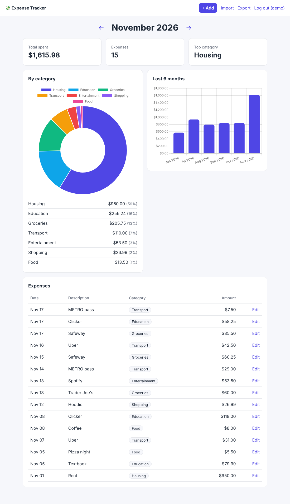

# 💸 Expense Tracker

A full-stack web app for tracking personal spending. Users create an account, log
expenses by category, and see monthly totals, a category breakdown and a 6-month
spending trend. Data can be imported from and exported to CSV.



**Live demo:** _add your deployed link here_

## Features

- **Accounts** – sign up, log in/out, "remember me"; passwords are hashed (never stored in plain text)
- **Expenses** – add, edit and delete expenses with amount, category, date and description
- **Monthly dashboard** – month-by-month navigation, total spent, top category, and a per-category breakdown
- **Charts** – category doughnut chart and a 6-month spending trend (Chart.js)
- **CSV import/export** – round-trip your data; imports are validated and all-or-nothing
- **Responsive** – works on phones, with automatic dark mode

## Tech stack

| Layer | Tools |
|---|---|
| Backend | Python 3, Flask (blueprints + app factory) |
| Database | SQLAlchemy 2.0 ORM; SQLite locally, PostgreSQL in production |
| Auth & security | Flask-Login, Werkzeug password hashing, Flask-WTF CSRF protection |
| Frontend | Jinja templates, plain CSS, Chart.js |
| Testing / CI | pytest (27 tests), GitHub Actions |

## Running locally

```bash
git clone https://github.com/<your-username>/expense-tracker.git
cd expense-tracker
python3 -m venv .venv
source .venv/bin/activate          # Windows: .venv\Scripts\activate
pip install -r requirements.txt
python run.py
```

Then open http://127.0.0.1:5000 and create an account.

Run the tests with:

```bash
pytest
```

## Design decisions

- **Money is stored as integer cents.** Floating-point numbers can't represent values like
  0.10 exactly (`0.1 + 0.2 == 0.30000000000000004`), so amounts are parsed with `Decimal`
  and stored as whole cents. They're only formatted as dollars for display.
- **Users can only see their own data.** Every query filters by the logged-in user. Requests
  for another user's expense return 404 rather than 403, so the app doesn't reveal that the
  record exists. This is covered by a test.
- **Aggregation happens in the database.** Category totals use SQL `GROUP BY` / `SUM`
  instead of loading every row into Python.
- **Security basics:** CSRF tokens on every form, logout via POST, a protection against
  open redirects in the login `next` parameter, the same error for a wrong username or
  password (so usernames can't be discovered), and CSV export that neutralizes
  spreadsheet formulas (CSV injection).
- **All-or-nothing CSV import.** If any row is invalid, nothing is saved and the user sees
  which lines to fix. This avoids half-imported files and duplicates on re-upload.

## Deploying (Render, free tier)

The repo includes a [`render.yaml`](render.yaml) Blueprint, so Render sets everything up:

1. Push this repo to GitHub.
2. On [Render](https://render.com), choose **New → Blueprint** and select the repo.
3. Click **Apply**. Render creates a PostgreSQL database and the web service, generates
   `SECRET_KEY`, and connects `DATABASE_URL` automatically.

The free web service sleeps when idle, so the first visit after a while can take a little
while to load.

## Possible next steps

- Monthly budgets per category with over-budget warnings
- Recurring expenses (rent, subscriptions)
- Search and filtering
- Database migrations with Flask-Migrate / Alembic
- A JSON REST API and a React frontend
